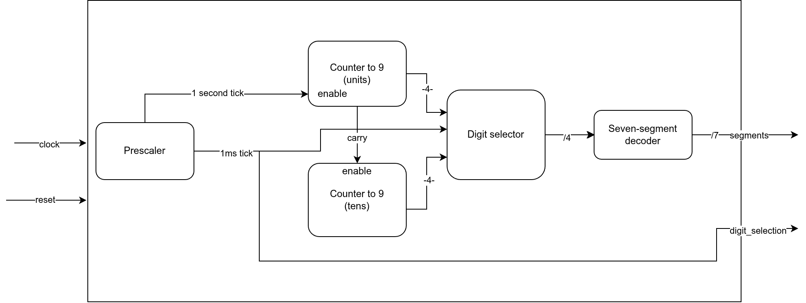

# 0 to 99 Counter on a 2-Digit 7-Segment Display

The goal of this project is to describe, in VHDL, a simple counter from 0 to 99 and show the count on a 2-digit 7-segment display. The specifications are simple:

1. The counter counts up from 0 to 99.
2. When it reaches 99, the counter wraps back to 0.
3. The counter has an asynchronous reset (active low) that sets the count back to 0.
4. The circuit is clocked by the output of a PLL generated from the vendor's IP.

## Block diagram

The source of the diagram is [design_diagram.drawio](design_diagram.drawio). The PLL that feeds the clock to every block is not shown.

## Concepts

This project covers the following concepts:

* Clocking through a PLL (vendor IP integration)
* Prescaler generating a 1-second tick
* Cascaded decade counters chained through their terminal-count (carry) signal
* 7-segment display encoding
* Multiplexing of the 2 digits
* Asynchronous reset
* Modular design with reusable components

## Technology

* Board: TD112 (developed by Tachysséma Développement), an FPGA module mounted on a carrier board with peripherals and Pmod connectors
* FPGA: Lattice Semiconductor CrossLink-NX LIFCL-40-8BG256I
* Display: Digilent Pmod SSD, 2-digit common-cathode 7-segment display
* Synthesis: Synopsys Synplify Pro
* Language: VHDL-2008
* Programmer: Radiant Programmer
* draw.io on Ubuntu for the diagrams

## Notes

As with any project, big or small, coding this counter brought up a few problems that turned into lessons learned. I wrote them down so I can come back to them in the future. You can find all of them in [NOTES.md](NOTES.md).
