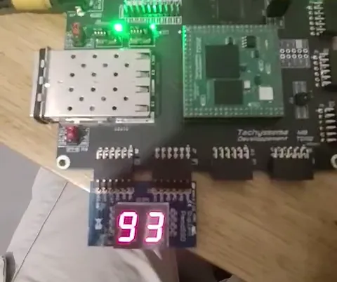

# 0 to 99 Counter on a 2-Digit 7-Segment Display



The goal of this project is to describe, in VHDL, a simple counter from 0 to 99 and show the count on a 2-digit 7-segment display. The specifications are simple:

1. The counter counts up from 0 to 99.
2. When it reaches 99, the counter wraps back to 0.
3. The counter has an asynchronous reset (active low) that sets the count back to 0.
4. The circuit is clocked by the output of a PLL generated from the vendor's IP.

## Block diagram


The source of the diagram is [design_diagram.drawio](design_diagram.drawio). The PLL that feeds the clock to every block is not shown.

## Concepts

This project covers the following concepts:

* Clocking through a PLL (vendor IP integration)
* Prescaler generating a 1-second tick
* Cascaded decade counters chained through their terminal-count (carry) signal
* 7-segment display encoding
* Multiplexing of the 2 digits
* Asynchronous reset
* Modular design with reusable components

## Technology

* Board: TD112 (developed by Tachysséma Développement), an FPGA module mounted on a carrier board with peripherals and Pmod connectors
* FPGA: Lattice Semiconductor CrossLink-NX LIFCL-40-8BG256I
* Display: Digilent Pmod SSD, 2-digit common-cathode 7-segment display
* Synthesis: Synopsys Synplify Pro
* Language: VHDL-2008
* Programmer: Radiant Programmer
* draw.io on Ubuntu for the diagrams

## How to build

### Requirements

* [Lattice Radiant](https://www.latticesemi.com/LatticeRadiant) 2026.1 or newer, which includes Synplify Pro and Radiant Programmer
* TD112 board with its USB-JTAG cable
* Digilent Pmod SSD

### Hardware setup

The Pmod SSD has two 6-pin headers, J1 and J2. Plug them into the odd-pin row (pins 1, 3, 5, 7, 9, 11) of two Pmod connectors on the TD112:

| Pmod SSD | TD112 connector | Signals |
|---|---|---|
| J1 | Pmod F (J7) | Segments a, b, c, d |
| J2 | Pmod G (J8) | Segments e, f, g and digit select |

The clock comes from the 100 MHz oscillator on the board, and the reset is the SW2 push button. The full relationship between the FPGA balls and the board connectors is in [docs/Pin_Mapping_TD112.pdf](docs/Pin_Mapping_TD112.pdf).

### Build the bitstream

1. Clone the repository:
   ```bash
   git clone https://github.com/mikemontilla/counter_to_99.git
   ```
2. Open `counter_to_99.rdf` in Radiant (*File → Open → Project*).
3. In the process toolbar, run **Export Files**. Radiant runs synthesis, map and place & route before generating the bitstream.
4. The bitstream is written to `counter_to_99_implementation/counter_to_99_counter_to_99_implementation.bit`.

### Program the FPGA

1. Connect the board to the computer through the USB-JTAG port.
2. Open Radiant Programmer (*Tools → Programmer*) with the project file `source/counter_to_99_implementation.xcf`. It is already set up to load the bitstream into the FPGA SRAM over JTAG.
3. If the cable is not detected, click **Detect Cable** and select it.
4. Click **Program**. The display starts counting from 00 to 99, once per second.

The configuration is stored in SRAM, so it is lost when the board is powered off. On Linux, if Radiant Programmer shows "Failed to Open FTDI USB port", see the [USB-JTAG programmer issue](NOTES.md#usb-jtag-programmer-issue) note.

## Notes

As with any project, big or small, coding this counter brought up a few problems that turned into lessons learned. I wrote them down so I can come back to them in the future. You can find all of them in [NOTES.md](NOTES.md).
